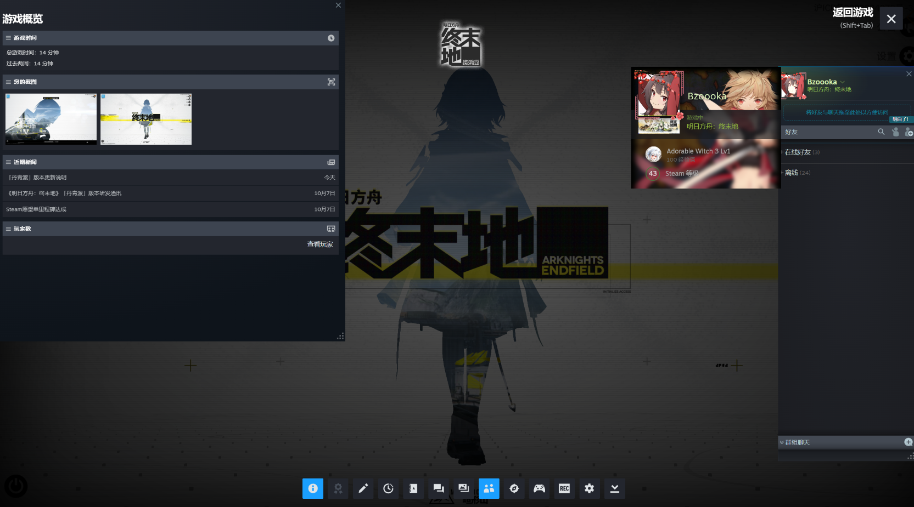
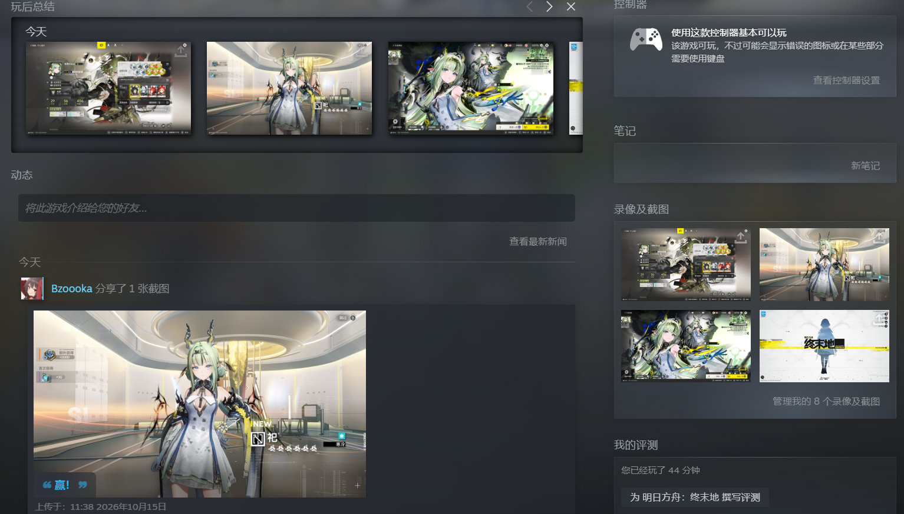
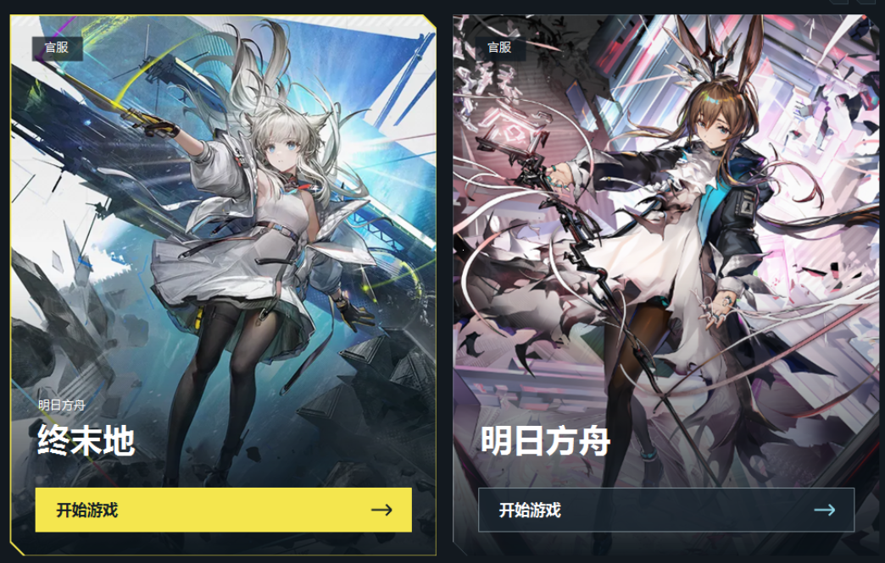

# Endfield Steam Bridge

通过 Steam 启动已有的国服客户端，无需下载 Steam 国际服。支持 Steam 游玩时长、Shift+Tab 叠加层和 F12 截图。

## 下载 v0.2.4

标准版与双启动特别版在同一个 [Release](https://github.com/SoledadAki/endfield-steam-bridge/releases/tag/v0.2.4) 中发布，按需下载一个即可。

| 版本 | 支持的游戏 | 下载 |
| --- | --- | --- |
| 标准版 | 终末地官服 / Bilibili 服 | [标准版](https://github.com/SoledadAki/endfield-steam-bridge/releases/download/v0.2.4/EndfieldSteamBridge_v0.2.4_standard.zip) |
| 官服明日方舟+终末地特别版 | 终末地官服 + 明日方舟官服 | [双启动特别版](https://github.com/SoledadAki/endfield-steam-bridge/releases/download/v0.2.4/EndfieldSteamBridge_v0.2.4_dual.zip) |

标准版运行 `EndfieldSteamBridge.exe`，双启动特别版运行 `EndfieldArknightsBridge.exe`。两个版本均为 Windows x64 程序包。

## 使用方法

1. 登录 Steam，将《明日方舟：终末地》加入游戏库；安装并登录对应国服客户端。
2. 退出游戏和鹰角启动器，解压程序包，以管理员身份运行工具。
3. 确认游戏路径并载入国服，之后从 Steam 开始游戏。
4. 双启动特别版会显示游戏选择界面，可启动终末地官服或明日方舟官服。

双启动特别版中，两款游戏的游玩时长与截图均归入 Steam《明日方舟：终末地》。

升级、切换服务器或切换版本前，请退出游戏和启动器，在新版中点击“撤回载入国服”，再重新载入。新版支持恢复旧版载入记录及旧版曾修改的启动设置。

## 演示

### Steam 游戏内叠加层

### Steam 截图与游玩记录

### 双启动特别版游戏选择

## 环境与源码

Windows 10/11 x64，.NET Framework 4.8。MIT 开源协议。

- `EndfieldSteamBridge/`：标准版源码。
- `EndfieldArknightsBridge/`：双启动特别版源码。

源码可从仓库下载，或在 Release 中选择 GitHub 自动生成的 Source code。构建与测试分别运行对应项目目录中的 `build.ps1` 与 `test.ps1`。
